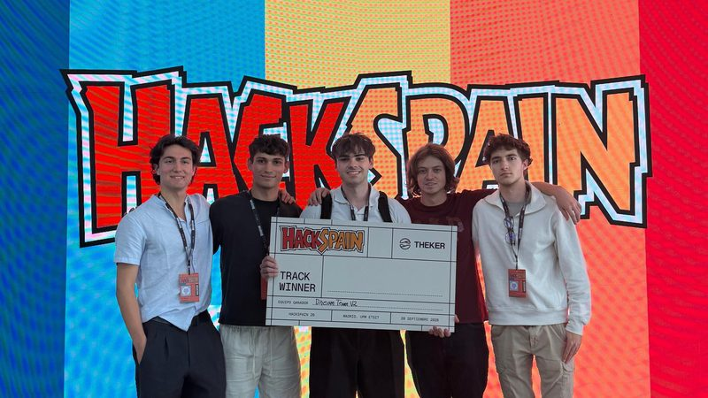
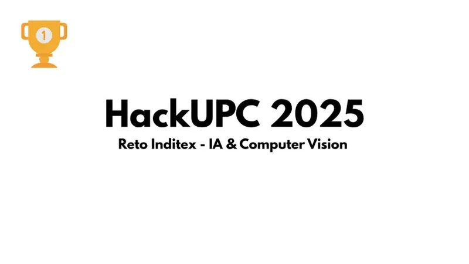
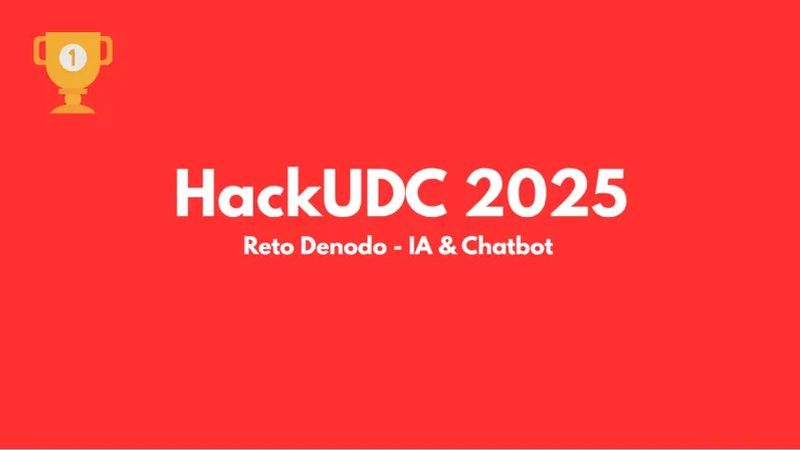

  

  

 

  &nbsp;
  &nbsp;
  &nbsp;
  

 

|  |  |  |  |
|:---:|:---:|:---:|:---:|

---

### 👋 &nbsp;About me

AI Engineer focused on **production-ready systems**: computer vision, Python backends, automated testing, observability and distributed GenAI workflows. I like owning the difficult middle, the part between a model that works in a notebook and a system that works in the real world.

Currently **GenAI & Computer Vision Engineer at CINFO** (since July 2024). BSc in Computer Engineering, Universidade da Coruña.

---

### 🎯 &nbsp;Professional impact

| | What | Outcome |
|:---:|---|---|
| 🎥 | **Real-time sports tracking & automatic camera control** · detection, tracking, prediction | **+50%** detection precision · **+80%** inference time |
| 🧪 | **Automated video testing infrastructure** · trajectory evaluation and performance metrics | Validation from **~8h to ~1h** (~87% faster) |
| 🧠 | **Distributed infrastructure for agent workflows** · parallel execution, checkpoints, recovery | Parallel agents with tracking & failure recovery |

Private work, summarized by challenge and outcome.

---

### 🏆 &nbsp;Hackathon wins

<table>
  <tr>
    <td align="center" width="33%">
      
       
       <b>Theker Track</b> · Madrid, UPM ETSIT · Sept 2026 Team Dream Team V2
    </td>
    <td align="center" width="33%">
      
       
       <b>InditexTECH Challenge</b> · Barcelona Europe's largest hackathon (+750 hackers) · <a href="https://github.com/EchoLook/echolook">EchoLook</a>
    </td>
    <td align="center" width="33%">
      
       
       <b>Denodo Challenge</b> · A Coruña Galicia's largest hackathon (+250 hackers) · <a href="https://github.com/martinge17/HackUDC25-Denodo">Data Assistant</a>
    </td>
  </tr>
</table>

---

### 🚀 &nbsp;Featured projects

| Project | What it does | Stack |
|---|---|---|
| **[EchoLook](https://github.com/EchoLook/echolook)** 🏆 | Find, try on and buy clothes using voice and visual AI | Vue · Node.js · PyTorch · Gemini · Whisper |
| **[ShelfPickVA](https://github.com/manuamest/ShelfPickVA)** | Bottle detection and shelf interaction with ROI configuration | Python · YOLO · OpenCV |
| **[Localdeck](https://github.com/manuamest/localdeck)** | Zero-config dashboard that discovers your local services | FastAPI · React · TypeScript · Docker |
| **[Diffy](https://github.com/manuamest/diffy)** | Lightweight, fast and beautiful code comparison tool | JavaScript |

---

### ⚡ &nbsp;Engineering capabilities

**Computer Vision & ML**
 
&nbsp;

**GenAI & Workflows**
 

**Backend & Systems**
 

**Production & Infrastructure**
 

---

### 📊 &nbsp;GitHub activity

  

 

  <picture>
    <source media="(prefers-color-scheme: dark)"  srcset="https://raw.githubusercontent.com/manuamest/manuamest/output/github-contribution-grid-snake-dark.svg"/>
    <source media="(prefers-color-scheme: light)" srcset="https://raw.githubusercontent.com/manuamest/manuamest/output/github-contribution-grid-snake.svg"/>
    
  </picture>

---

  <b>Looking for an engineer who can bridge AI and production?</b>
   
  Open to Computer Vision, GenAI and Applied AI roles · <a href="mailto:amestoymanu@gmail.com">amestoymanu@gmail.com</a>
    
  

  

